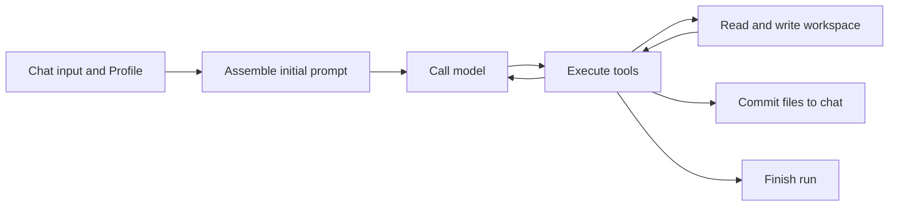

# Agent

TauriTavern's agent handles tasks with a model-and-tool loop. Chat commits its working files into the chat, and Session replies directly inside a persistent conversation; both share the frontend PromptManager and the Rust core.

Chat separates the writing process from what the chat shows: drafts can be revised repeatedly, reference material is read on demand, and only committed content appears in the chat.

## From files to workspace

Each Chat generation creates a run and a workspace. `output/` holds output, `scratch/` holds drafts, and `summaries/` holds summaries; content that should carry into later runs goes in `persist/`.

A chat has a stable identity, so renaming it does not change workspace ownership. The runs of one chat are stored together, and persistent content links one run to the next as a separate version. When you switch swipe, you can continue from the version attached to the selected message.

Files are how the agent organizes its working material. Chat history, World Info, and skills keep their own storage and supply what is needed through tools; the model does not have to read everything at the start. See [Workspace](Workspace.md) for directories and persistent versions.

## Running the loop in a workspace

Every round of the agent loop does the same thing: send the current context, execute the tool calls the model proposes, and add the results to the context.

Profile specifies the model, the prompt, the available tools, and the workspace scope. In Chat the model commits chat content with `workspace.commit` and completes the run with `workspace.finish`; a background writing run can produce files only.

Session is independent of character chats and uses a designated preset, a shared dedicated Profile, and a persistent workspace. The entry point is `api.agent.sessions`; see [Agent API](../API/Agent.md#persistent-sessions). See [Run loop](Runtime.md) and [Workspace](Workspace.md#the-persistent-session-workspace) for the run and storage rules respectively.

Supplementary instructions added during a Chat run enter the context before the next model request. Cancelling ends the current run, and content already confirmed as committed is kept. See [Run loop](Runtime.md) for the steps and the source entry points.

## Reconstructing a run from the journal

Each run appends events to `events.jsonl` in order, recording model rounds, tool calls, file changes, commits, and the final state. Timeline renders the process from these records; larger tool results and model responses are stored as separate files, and the events keep references to them.

Working files can change while the events already written stay as they are. So even after closing the page you can read the journal again to learn what happened during that run. The journal and the retained files together support review and diagnosis; see [Run event journal](RunEventJournal.md) for how to read them. See [Run loop](Runtime.md#checkpoints-and-recovery) for checkpoint-based recovery and output revision.

## Connecting agents with tasks

A Chat run can contain several Invocations. An Invocation is one execution of a Profile, with its own model context and tool loop, and it shares the workspace with the other Invocations of the same run.

Interaction between agents works like a pipeline: the caller sends a task package, the receiver processes it and sends back a result package, and file paths carry the larger material. The source records this transfer in `AgentTaskRecord` and uses `continuation` to distinguish the two follow-up actions:

- Delegation (`return_to_parent`): the child agent works in the background, the caller can keep working, and it collects the result later through `agent.await`.
- Handoff (`transfer_control`): the current agent ends its own loop, and the next agent takes over the foreground work and the final commit.

Both forms reuse the same loop and workspace. See [Multi-agent collaboration](SubAgent.md) for usage.

## Getting started

1. Configure a model that supports tool calls in a chat completion connection, and save the current preset.
2. Open Extensions → Agent System in the rail, choose `Default Writer`, and turn on Agent Mode.
3. Send a message as usual, then inspect the tool calls, the workspace, and the commit result in the run history.

The SillyBunny In-Chat Agents UI is installed separately as the `sb-agents` extension; open
Extensions → In-Chat Agents. It is a different setup UI from the native Agent System and shares the
same agent runtime.

The default Profile uses the current chat's preset and model. When you need a dedicated writing, proofreading, or research agent, copy a Profile and set its instructions and tools. See [Profiles and presets](ProfilesAndPreset.md) for configuration.

## Where to look for each task

| Task | Documentation |
| --- | --- |
| Understand files, chat commits, and cross-run state | [Workspace](Workspace.md) |
| Change startup, the loop, and wrap-up | [Run loop](Runtime.md) |
| Read history, implement Timeline | [Run event journal](RunEventJournal.md) |
| Configure agents, standalone models, and presets | [Profiles and presets](ProfilesAndPreset.md) |
| Change prompt assembly | [Prompt assembly](PromptAssembly.md) |
| Use delegation or handoff | [Multi-agent collaboration](SubAgent.md) |
| Add tools or connect MCP | [Tools](ToolSystem.md) |
| Change model adaptation and continuation | [LLM gateway](LlmGateway.md) |
| Write knowledge packages or scripts | [Skill](Skill.md) |
| Call the agent from an extension | [Agent API](../API/Agent.md) |
| Verify a change | [Testing](TestingStrategy.md) |

The backend still follows the repository's [crate boundaries](../BackendStructure.md). The agent documentation maintains current behaviour only; look up fields and defaults in the corresponding type or implementation, and the topic pages explain usage and ownership.
