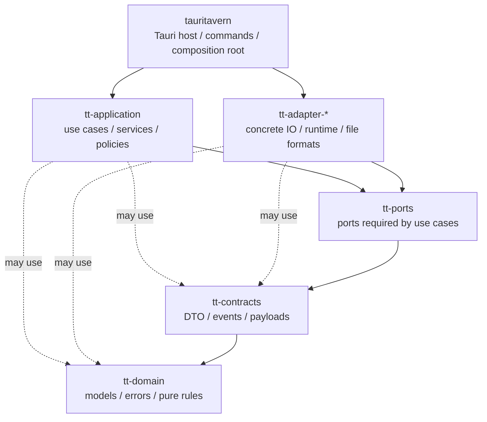

# TauriTavern backend structure

This document describes the **Clean Architecture principles, workspace crate boundaries, dependency directions, and where code belongs** in the TauriTavern Rust backend.

It is not an API command list, and not an encyclopedia of individual features. API details live in `docs/API/`, a snapshot of the current implementation lives in `docs/CurrentState/`, and the frontend host contract lives in `docs/FrontendHostContract.md`.

## 1. The highest constraint: Clean Architecture

Clean Architecture is the most important long-term constraint on the TauriTavern backend. It is not a set of attractive directory names; it is a dependency rule:

> Code that is more stable and closer to business semantics sits further in; code that depends on frameworks, the file system, the network, or platform APIs sits further out; source dependencies may only point from the outer layers to the inner ones.

In this project the rule has several direct consequences:

- Domain models and pure rules cannot know about Tauri, the file system, HTTP, an async runtime, or repositories.
- A use case can say "I need some kind of external capability" but cannot depend on a specific implementation.
- Concrete IO, file formats, network requests, ZIP, PNG, tokenizer, and sync runtime are all outer-layer details.
- The host may know every implementation, because it starts and assembles them; but that knowledge must stay near the composition root.
- The browser-observable SillyTavern compatibility semantics are an external contract and cannot be replaced by the Rust internal layering names.

As a result, Clean Architecture here is not maintained by convention. It is materialized and enforced automatically by the Cargo workspace and `scripts/check-rust-crate-boundaries.mjs`.

## 2. From principles to crates

The current workspace crate split is the physical boundary of Clean Architecture. When reading these crates, do not ask "what does this file technically use"; ask "which class of change does this code belong to".

| Clean Architecture concept | Current home | Stable responsibility | Must not own |
| --- | --- | --- | --- |
| Entities / domain core | `tt-domain` | Domain models, value objects, domain errors, pure rules, pure text/JSON helpers | Repository traits, async runtime, file system, network, Tauri |
| Cross-crate contracts | `tt-contracts` | Cross-crate DTOs, events, payloads, observability, shared value contracts | Concrete IO, application services, Tauri |
| Application ports | `tt-ports` | Repository traits, gateway traits, event sink, runtime port, Host Resource opened-source port | Concrete adapters, reqwest/axum/tauri/image/zip implementations |
| Use cases | `tt-application` | Services, use cases, job coordinator, policy orchestration | Tauri, adapters, reqwest, concrete tokenizer, file format implementations |
| Interface adapters | `tt-adapter-*` | Tauri-free concrete IO, runtime, persistence, file formats, external system access | Application services, Tauri host glue |
| Frameworks / Drivers | `tauritavern` | Tauri builder, plugins, setup, window, commands, composition root, platform glue | Domain rules, use case implementations, Tauri-free repositories |

Two points here are easy to confuse and matter:

- `tt-domain` does not define repository traits. A repository is a use case's need from the outside world, so it is a port, not a domain entity.
- `tt-adapter-*` is not "more core" than application. It may be complex, but complexity is not inner-ness. Anything that depends on the file system, the network, third-party formats, or runtime details is an outer layer.

## 3. Workspace overview

The workspace root is `src-tauri/Cargo.toml`, and the default member is `crates/tauritavern`.

```text
src-tauri/
├── Cargo.toml
├── Cargo.lock
├── resources/
└── crates/
    ├── tauritavern
    ├── tt-domain
    ├── tt-contracts
    ├── tt-ports
    ├── tt-application
    ├── tt-adapter-http
    ├── tt-adapter-mcp
    ├── tt-adapter-provider-http
    ├── tt-adapter-vector
    ├── tt-adapter-tokenization
    ├── tt-adapter-storage-core
    ├── tt-adapter-storage-userdata
    ├── tt-adapter-media
    ├── tt-adapter-extension
    ├── tt-adapter-workspace-shell
    ├── tt-adapter-triviumdb
    ├── tt-adapter-sync
    └── tt-adapter-archive
```

The host no longer carries every backend implementation; use cases, ports, contracts, the domain, and concrete adapters have been split into separate Cargo crates. Future maintenance is not about chasing more crates, but about preventing the boundary from flowing back in and making sure every new capability lands on the correct axis of change.

| crate | Current responsibility |
| --- | --- |
| `tauritavern` | Tauri host, presentation commands, composition root, host-bound infrastructure, platform glue |
| `tt-domain` | Domain models, value objects, domain errors, pure rules |
| `tt-contracts` | DTOs, events, payloads, shared value contracts, observability contract |
| `tt-ports` | Repository / gateway / runtime traits, Host Resource opened-source port |
| `tt-application` | Use case services, business orchestration, job coordination, policy execution |
| `tt-adapter-http` | Shared HTTP client pool/profile/helpers |
| `tt-adapter-mcp` | RMCP client, protocol version policy and Streamable HTTP lifecycle, tools/list pagination and tool validation |
| `tt-adapter-provider-http` | HTTP repositories for LLM, SearXNG, SD, Translate, embedding, and provider metadata |
| `tt-adapter-triviumdb` | Namespace-scoped TriviumDB management, blocking execution, native queries, and persistence |
| `tt-adapter-vector` | Vector's ACID local index and local embedding runtime; carries no provider HTTP |
| `tt-adapter-tokenization` | Tokenizer concrete repository |
| `tt-adapter-storage-core` | `DataDirectory`, base file system and format helpers, chat/settings/user/theme/secret/quick reply/prompt cache/asset/llm connection/extension-store |
| `tt-adapter-storage-userdata` | character, world info, agent workspace, agent profile, skill local package store, PNG card metadata |
| `tt-adapter-media` | persona/avatar/background/user media/image metadata, browser-visible host resource file store |
| `tt-adapter-extension` | Third-party extension discovery, installation, version checks, updates, branch queries/switching, deletion and moving; Gitoxide smart HTTP and the embedded worktree |
| `tt-adapter-workspace-shell` | Bashkit (including jq/Python) and QuickJS execution; scoped `WorkspaceFs` adaptation |
| `tt-adapter-sync` | LAN Sync, TT-Sync v2 runtime, stores, client/server, sync jobs |
| `tt-adapter-archive` | Data archive import/export executor, archive path safety |

## 4. Dependency directions

Arrows show the direction of Rust crate dependencies. They should always point at the more inner, more stable policies and contracts.



A small number of adapter-to-adapter helper relationships are allowed today:

```text
tt-adapter-provider-http    -> tt-adapter-http
tt-adapter-mcp              -> tt-adapter-http
tt-adapter-tokenization     -> tt-adapter-http
tt-adapter-extension        -> tt-adapter-http + tt-adapter-storage-core
tt-adapter-storage-userdata -> tt-adapter-storage-core
tt-adapter-media            -> tt-adapter-storage-core
```

Forbidden directions:

- `tt-domain` does not depend on `tt-ports`, `tt-contracts`, adapters, Tauri, the network, or the file system.
- `tt-contracts` does not depend on `tt-ports`, `tt-application`, adapters, or Tauri.
- `tt-ports` does not depend on adapters, Tauri, or concrete network/file system implementations.
- `tt-application` does not depend on any `tt-adapter-*`, `tauritavern`, `reqwest`, `axum`, `tauri`, `zip`, or `image`.
- No `tt-adapter-*` depends on `tt-application` or `tauritavern`.
- The host's `infrastructure` and `platform` do not leak downward as implicit dependencies of application or adapters; concrete service assembly is centralized in `app/composition`.

If new code would need to violate these directions, the usual cause is not an over-strict boundary script but an abstraction whose home has not been thought through.

## 5. Upstream compatibility contract

TauriTavern does not replicate SillyTavern's Node/Express implementation details. It replicates the contract the upstream frontend, extensions, scripts, and character cards can observe:

- Same-origin URLs, HTTP methods, status codes, request body parsing, and JSON/text/stream response shapes.
- Upload field names and resource paths, such as `/characters/*`, `/User Avatars/*`, `/backgrounds/*`, `/assets/*`, `/user/images/*`, `/user/files/*`, `/scripts/extensions/third-party/*`.
- File layouts such as chat JSONL, character card PNG metadata, World Info, presets, themes, and user directories.
- Upstream `eventSource` event semantics, such as generation, World Info, stream token, and tool call events.

Rust commands, Tauri channels, and the repository/service layering are internal implementation. They are not a compatibility API exposed to extension authors.

The real path of compatibility traffic is:

```text
SillyTavern frontend / extension / script
  -> same-origin fetch / jQuery.ajax
  -> src/tauri/main/interceptors.js
  -> src/tauri/main/routes/*
  -> context.safeInvoke(...)
  -> tauritavern presentation command
  -> tt-application service
  -> tt-ports trait
  -> tt-adapter-* concrete implementation
```

New TauriTavern capabilities are exposed through `window.__TAURITAVERN__.api.*` first. Only behavior that genuinely matches an upstream SillyTavern route enters the `/api/*` compatibility layer.

## 6. Host boundary

`tauritavern` is the outermost host crate. It may know every concrete implementation, but should only use them at explicit boundaries.

Main directories:

```text
src-tauri/crates/tauritavern/src/
├── lib.rs                 # host lib entry, delegates to app::host::run() only
├── main.rs                # desktop entry
├── app/
│   ├── host/              # Tauri builder, plugin, setup, window, resources, shutdown
│   ├── composition.rs     # composition root entry
│   ├── composition/       # repositories, services, host adapters assembly
│   ├── state.rs           # AppState / AppServices / lifecycle handles
│   └── startup_profile.rs # startup settings / policy snapshot
├── presentation/          # Tauri commands, CommandError, web resource adapter
├── infrastructure/        # Tauri-bound infrastructure
└── platform/              # host identity and WebView transport budget (fixed on Windows)
```

### 6.1 Host shell

`app/host/*` is the Tauri shell:

- Installs plugins.
- Resolves runtime paths.
- Initializes logging, the HTTP pool, bundled templates, and the host resource service.
- Creates windows and installs the web resource request hook.
- Starts asynchronous AppState initialization.

This code may touch `tauri::AppHandle`, windows, plugins, and platform APIs. It contains no business use cases.

### 6.2 Composition root

`app/composition/*` is the only place that may know application services and concrete adapters at the same time.

Maintenance rules:

- Commands do not construct repositories directly.
- Services do not construct concrete adapters directly.
- Adapters do not call application services.
- `AppState` holds only the long-lived service bundle, lifecycle handles, and the startup policy snapshot; it does not sink into application or adapters as a global service locator.

The composition input is `HostEnvironment` (`app/host/environment.rs`): the HTTP client pool, agent extension tools, and the optional generation background runtime. `app/composition/services/mod.rs` receives that environment plus the app root and data directory. The Windows fork passes `None` for the generation background runtime because that surface is out of scope; constructors accept the option instead of reaching into Tauri state.

Perf instrumentation is behind the `perf` feature. `tests/perf/backend.mjs` replays the frontend suite's host-call trace through `tt-perf` and compares the working tree with HEAD using Windows process I/O counters. The Linux callgrind and macOS instruction-counter paths are not carried in this fork.

### 6.3 Host-bound infrastructure

Only code that genuinely depends on `AppHandle`, the WebView, Tauri plugins, bundled resources, runtime paths, platform APIs, or the host lifecycle stays in `tauritavern/src/infrastructure` or `platform`.

Examples that legitimately stay in the host today:

- Runtime paths and the data directory selection bootstrap configuration.
- Reading bundled resources.
- The parts of logging and Dev observability that need Tauri events or the AppHandle.
- The Tauri file picker/share glue for Data Archive.
- `file_content_repository` and `file_preset_repository`, which still depend on packaged default content and bundled resources.
- Small host-bound API glue, such as the update check and the external import downloader.

New Tauri-free repositories should not go back into host infrastructure.

### 6.4 Platform facts

This branch builds the Windows x64 desktop app only. `HOST_IDENTITY` in `platform/identity.rs` is the single source of truth, fixed to `windows` plus `desktop`, and is injected into the frontend (see `docs/FrontendHostContract.md` §2.2).

- The host crate no longer keeps platform code that branches on `target_os` / `target_env`; build targets other than Windows are unsupported.
- Non-host crates do not read the platform; the composition root injects the difference either as a fact (such as `HostKind`) or as a number (such as the IPC frame budget).
- New platform-specific code should be written as a Windows implementation directly, with no new conditional compilation.

## 7. Adapter boundaries

Adapters are outer-layer details, but they are not a common bucket where anything may pile up. One adapter crate should correspond to one clear bounded context, or to one stable set of change reasons.

Current practice:

- `tt-adapter-storage-core` carries only base data root capabilities and the lower-level file system helpers. It is not the new big bucket for "all file repositories".
- `tt-adapter-storage-userdata` carries long-lived user data repositories, such as character cards, world info, Agent workspace/profile, and skill packages. It cares about data root and user data semantics, not about "files" in general.
- `tt-adapter-extension` carries third-party extension discovery, installation, version checks, updates, branch queries/switching, deletion and moving, plus the Git transport, repository, and worktree materialization boundary. An extension repository is not ordinary user data JSON.
- `tt-adapter-media` carries the browser-visible avatar/background/user media resource contract.
- `tt-adapter-workspace-shell` provides execution through `WorkspaceShell` and file access through `WorkspaceFs`; permissions, skill binding, frozen macro projection, and publication policy belong to application.
- `tt-adapter-provider-http`, `tt-adapter-mcp`, and `tt-adapter-tokenization` may reuse `tt-adapter-http`, but protocol and provider rules must not sink into the shared HTTP helpers.
- `tt-adapter-sync` and `tt-adapter-archive` are independent runtime/executor boundaries, while the Tauri UI glue stays in the host.

If a new adapter exists only to abstract two call sites ahead of time, do not create the crate yet. Split it out when it has a clear bounded context, an independent dependency cost, or a stable set of change reasons.

## 8. Presentation boundary

`presentation` is the boundary for Tauri commands the frontend can call and for WebView resources.

Rules:

- `#[tauri::command]` lives only in `presentation/commands/*`.
- A command parses arguments, gates policy, maps errors, and calls services; it contains no complex business flow.
- The command registry is centralized in `presentation/commands/registry.rs`.
- Upstream-compatible `/api/*` behavior is maintained mainly by the frontend route shims; Rust command names are not a stable third-party API.
- Browser subresources must be served through real, loadable URL/Response semantics; do not fake resource loading with IPC/base64.

## 9. Code placement decision table

| Need | Location | Notes |
| --- | --- | --- |
| New domain model, value object, pure validation | `tt-domain` | No async, IO, or repository traits |
| New cross-crate payload/event/DTO | `tt-contracts` | Contracts only, no services |
| New repository/gateway/runtime trait | `tt-ports` | Traits face application; concrete implementations do not belong here |
| New use case, business orchestration, job coordinator | `tt-application` | Depends on ports, not adapters |
| New Tauri command | `tauritavern/src/presentation/commands` | Calls services, never touches repository details directly |
| New service/adapter assembly | `tauritavern/src/app/composition` | Construct explicitly; avoid DI containers or auto-registration magic |
| Needs AppHandle/WebView/plugin/platform APIs | `tauritavern/src/app`, `infrastructure`, or `platform` | Do not sink into adapters |
| Behavior that differs by platform | Injected in `tauritavern/src/app/composition` | Non-host crates do not read the platform; see §6.4 |
| Base file repositories for data root/default-user | `tt-adapter-storage-core` | Base storage such as chat/settings/user/theme/secret |
| Character cards, world info, Agent workspace/profile, skill packages | `tt-adapter-storage-userdata` | A skill is a local package store, not an ordinary JSON repo |
| Third-party extension install, update, discovery | `tt-adapter-extension` | Not part of storage-userdata |
| avatar/background/user media/host resource file reads | `tt-adapter-media` | Keep the browser resource contract |
| LLM/SearXNG/SD/Translate/provider metadata/embedding HTTP | `tt-adapter-provider-http` | Reuses `tt-adapter-http` |
| Vector index and local embedding runtime | `tt-adapter-vector` | Independent persistence/inference dependencies; does not sink into storage-core |
| Shared HTTP pool/profile/helpers | `tt-adapter-http` | No provider business rules |
| LAN/TT Sync runtime | `tt-adapter-sync` | Tauri event/UI adapters stay in host composition |
| Data Archive import/export executor | `tt-adapter-archive` | Tauri picker/share stays in host infrastructure |
| Workspace shell, jq, Python, and JavaScript execution | `tt-adapter-workspace-shell` | Depends on the `WorkspaceShell` / `WorkspaceFs` ports and reuses the caller's file scope; never touches physical paths |

## 10. Minimum path for adding a backend capability

When adding a capability, start from the contract and the reason for change, then decide where the file belongs:

1. Decide whether this is upstream-compatible behavior or a new TauriTavern capability.
2. Upstream-compatible behavior keeps `/api/*`, resource paths, stream, and event semantics.
3. New capabilities go through `window.__TAURITAVERN__.api.*` first.
4. If there is a new business concept, put it in `tt-domain` first.
5. If there is an external IO or persistence boundary, define the smallest trait in `tt-ports`.
6. Write the service/use case in `tt-application`.
7. Write the concrete implementation in the appropriate `tt-adapter-*`.
8. Assemble it in `tauritavern/src/app/composition`.
9. Add the command in `tauritavern/src/presentation`.
10. Wire it up in the frontend route or Host ABI layer.
11. Update the related documentation and guards/tests.

If a new abstraction has only one implementation, do not add it yet. In a Rust project, explicit construction is usually easier to maintain than generic DI, factories, or inventory/linkme.

## 11. Data directory and file layout

The data directory layout is part of the SillyTavern compatibility contract. Directory name casing and spaces must not be changed casually, for example:

- `default-user`
- `characters`
- `chats`
- `group chats`
- `User Avatars`
- `QuickReplies`
- `OpenAI Settings`
- `TextGen Settings`

Private TauriTavern state in user data lives under `_tauritavern`, for example agent workspace, agent profiles, skills, prompt cache, legacy extension source metadata, and LLM connections. Security state that can grant host permissions is not user data: custom endpoint grants live in `app_root/security` and do not move with the switchable `data_root`, a backup, or an import.

Authoritative code entry points:

- `src-tauri/crates/tt-adapter-storage-core/src/file_system.rs`
- `src-tauri/crates/tt-domain/src/models/user_directory.rs`
- For the current state of desktop data directory selection, see `docs/CurrentState/DataDirectorySelection.md`

Settings partitioning and migration belong to the settings repository in `tt-adapter-storage-core`, and the frontend API keeps receiving the complete settings object. See [Sync](CurrentState/Sync.md#independent-settings-scope) for the synchronization agreement.

Settings saves reuse shared byte commits; the domain layer defines repair and revision rules, and the application layer coordinates saving, restoring, and the separate Persona confirmation. Repositories and archives share the file manifest and repair rules, and reads and archive projections never write back to the source data.

File writes are bounded by atomic single-file publication, and persistent writes sync the file before publication; a failure is not retried as an overwrite copy. See [the file system implementation](../src-tauri/crates/tt-adapter-storage-core/src/file_system.rs) for the exact guarantees. No repository dependency is introduced across adapters just to reuse a file helper.

## 12. Topic document map

`BackendStructure.md` keeps only the overall boundaries. Details live in the topic documents:

| Topic | Document |
| --- | --- |
| Frontend Host ABI, request interception, resource contracts | `docs/FrontendHostContract.md` |
| Frontend integration structure | `docs/FrontendGuide.md` |
| Extension author API | `docs/API/README.md` |
| Chat payload (full history, atomic commits, read-only pagination) | `docs/CurrentState/ChatPayload.md` |
| Third-party extension resources and discovery | `docs/CurrentState/ThirdPartyExtensions.md` |
| Media Range / browser resource contract | `docs/CurrentState/MediaAssetContract.md` |
| Logging / Dev observability | `docs/CurrentState/LoggingObservability.md` |
| Native provider API formats | `docs/CurrentState/NativeApiFormats.md` |
| Custom endpoint SSRF and user authorization | `docs/CurrentState/UserEndpointAccess.md` |
| Vector compatibility layer | `docs/CurrentState/VectorApi.md` |
| Sync | `docs/CurrentState/Sync.md` |
| Agent overview | [Agent](Agent/README.md) |
| Agent details | `docs/Agent/README.md` |

## 13. Verification

After changing an architectural boundary, at minimum run:

```bash
pnpm run check:rust-boundaries
```

Add the following according to the blast radius:

```bash
pnpm run test:rust
pnpm run check:rust:dev
cargo test --manifest-path src-tauri/Cargo.toml -p <affected-crate> <focused-test>
```

When frontend route shims, the Host ABI, or resource endpoints are involved, also run the frontend contract/guards:

```bash
pnpm run check:frontend
pnpm run check:types
pnpm run test:contracts
```

## 14. Common mistakes

- Do not read Clean Architecture as "create a few more directory layers". The real boundary is dependency direction and reason for change.
- Do not put repository traits back into `tt-domain`.
- Do not let `tt-application` depend on concrete adapters.
- Do not let adapters depend on `tauritavern`, `AppState`, or presentation commands.
- Do not push Tauri-free file repositories back into host infrastructure.
- Do not turn `tt-adapter-storage-core` into a new common bucket.
- Do not extract a generic `common-archive` crate ahead of time for two ZIP call sites; wait for a third real bounded context.
- Do not treat Tauri command names as a public extension API.
- Do not replace native browser subresource semantics with IPC/base64.
- Do not silently degrade an upstream contract. When a field cannot be preserved faithfully, provider metadata cannot express something, or a directory state cannot be recovered, fail explicitly.

### Moving-window background boundary

`tt-contracts::window_layout` defines the window snapshot and the background request. Main WebView layout and the discarding of stale results belong to the shell glue in `tauritavern::platform`. `tt-adapter-media::window_backdrop` performs the Tauri-free resource read, decode, and strip cropping, reusing the Host Resource Store.
